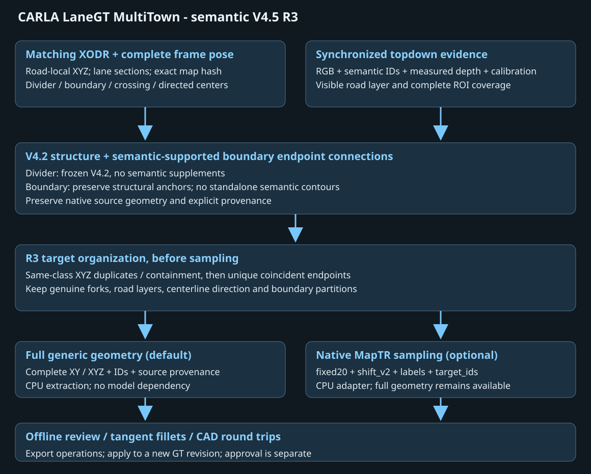
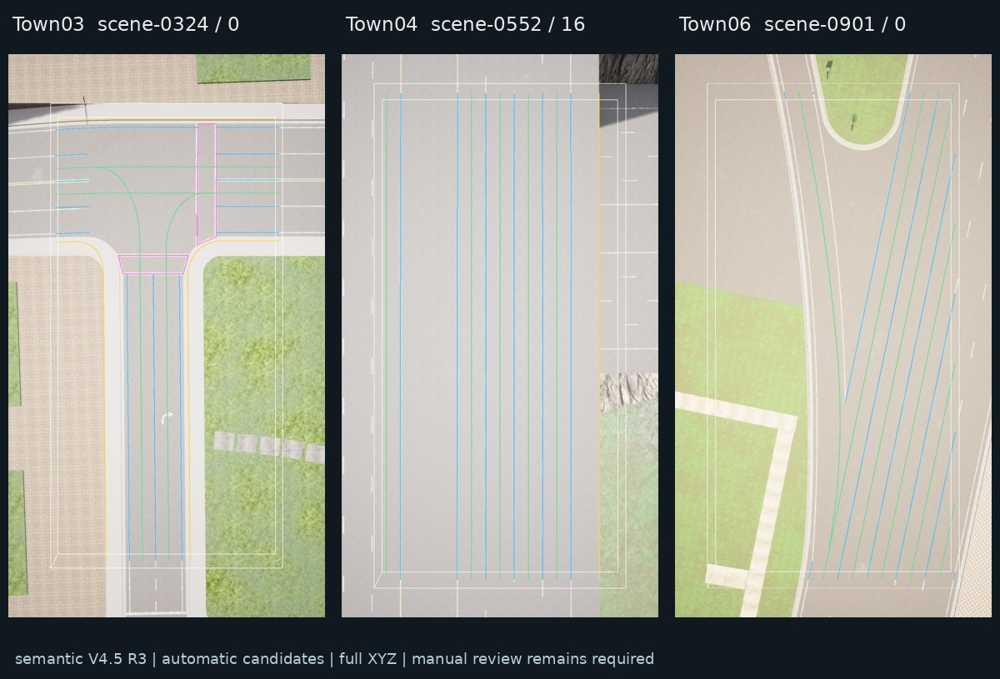
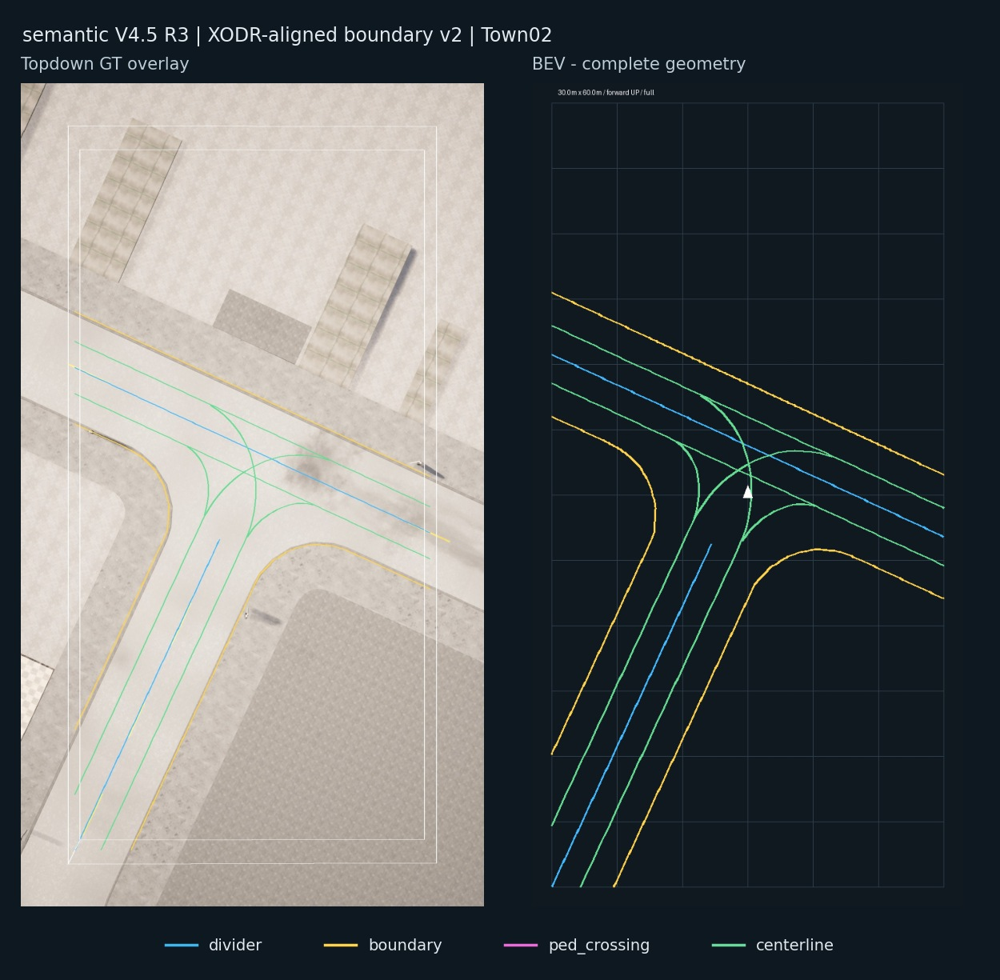
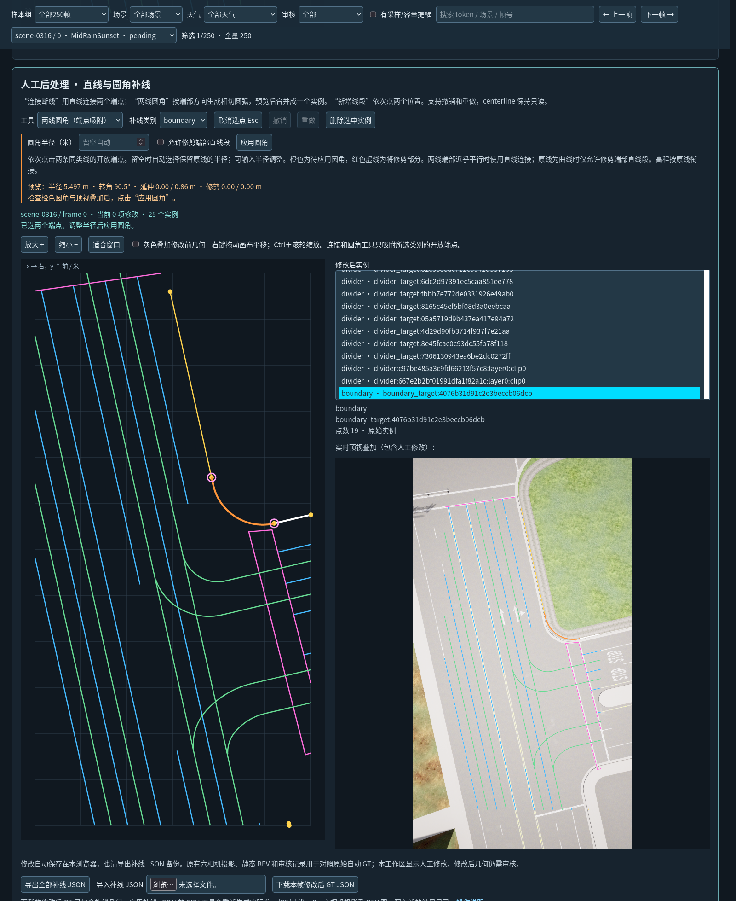

# CARLA LaneGT MultiTown

English | [中文](README.md)

A CARLA vector-map ground-truth toolkit with full XYZ geometry, offline multi-camera / BEV review, tangent fillet editing, CAD round trips, and optional native MapTRv2 sampling.

**Software 1.1.0 · default method semantic V4.5 R3 + XODR-aligned boundary v2 · XODR-only V4.2 geometry baseline.** This is a new MultiTown repository derived from the earlier Town10 toolkit.



## Method

- **Divider:** native V4.2 road marks and geometry connections; semantic divider supplements are disabled.
- **Boundary:** pinned V4.2 road-local structure. Semantic IDs and measured depth guide endpoint connections. Locally measured signed offsets transport the fitted guide back to the XODR outer edge; output Z follows native endpoint heights and grades. Standalone observed contours are not added.
- **Pedestrian crossing:** matching XODR objects. An explicitly empty source remains empty.
- **Centerline:** matching XODR lane centers, with directed point order preserved; optional generated or provided centers.

Before sampling, same-class XYZ duplicates and fully contained subcurves are consolidated; unique coincident endpoints may form a continuous target. Real branches, different elevations, parallel lines, centerline direction and intentional boundary partitions remain separate. Full geometry and source provenance are retained.

The aligned boundary method is enabled by default; no additional `--policy` is needed. Search is limited by the calibrated reference, XODR topology and measured evidence, rather than fixed 8m / 30m cutoffs. The lateral bias is estimated locally, with no global fixed shift. A consistent separation from the visible curb can remain under the XODR edge definition. See [boundary alignment](docs/BOUNDARY_ALIGNMENT.md).

## Cross-Town use

The pipeline has been tested across Town01–Town07 and Town10 (Town10HD/Opt) in CARLA 0.9.16 and is generally feasible. Remaining line gaps, missing segments and incorrect lines can be corrected with the offline manual editor, tangent fillets or CAD round trips.



Source maps, images, depth arrays, annotations and model weights are not distributed. Only a few documentation illustrations are included.

## Setup and single-frame workflow

Use Linux and a separate Python 3.8–3.10 geometry environment:

```bash
python -m pip install -r requirements.txt
python tools/prepare_map.py --map Town03 --xodr /data/maps/server_Town03.xodr
cp config/paths.example.json /tmp/town03-paths.json
# Edit this JSON with the generated map_profile and your actual input paths.
python tools/configure.py --from-json /tmp/town03-paths.json \
  --output config/paths.town03.local.json
python run.py --paths config/paths.town03.local.json doctor --topdown-only
python run.py --paths config/paths.town03.local.json check --limit 1 --topdown-only
python run.py --paths config/paths.town03.local.json extract --limit 1 \
  --topdown-only --centerline generate --output outputs/gt1
python run.py --paths config/paths.town03.local.json review \
  --source outputs/gt1 --output outputs/review1
```

Open `outputs/review1/gallery.html` in Firefox. Output directories must be new. `prepare_map.py` builds ignored local resources from your matching XODR without starting CARLA; `--world` can reuse an explicitly provided matching V4.2 cache. Topdown-only inputs do not require six-camera data. Ordinary photos alone cannot supply semantic IDs, measured depth, synchronization, calibration and complete poses.

The default output is full generic geometry without model imports. Configure an external MapTRv2 checkout and interpreter, then explicitly request `--sampler maptr` for native fixed20 / shift_v2 arrays. Extraction and sampling use CPU. Only `collect --execute` starts CARLA / GPU capture.

## Review and editing



*XODR-aligned boundary v2 in Town02: topdown GT overlay and complete BEV geometry from the same frame, colored by annotation class.*



The offline gallery supports review, straight connections, tangent circular connections, undo / redo, patch JSON and CAD DXF import / export. Centerlines remain read-only in the manual editor. Longer consolidated centerlines can increase the error of a fixed 20-point representation; full XYZ geometry is retained for comparison. Annotations should be reviewed before use for training.

See the Chinese technical documentation for [inputs](docs/INPUTS.md), [configuration](docs/CONFIGURATION.md), [quick start](docs/QUICKSTART.md), [algorithm](docs/ALGORITHM.md), [sampling](docs/GENERIC_GT.md), [capture](docs/CAPTURE.md), [editing](docs/POSTPROCESSING.md), [known issues](KNOWN_ISSUES.md), and [release scope](docs/RELEASE.md).

Project code is MIT licensed. CARLA, MapTRv2, maps and datasets retain their own terms; see [third-party notices](THIRD_PARTY_NOTICES.md) and [source provenance](RELEASE_SOURCE.json).
