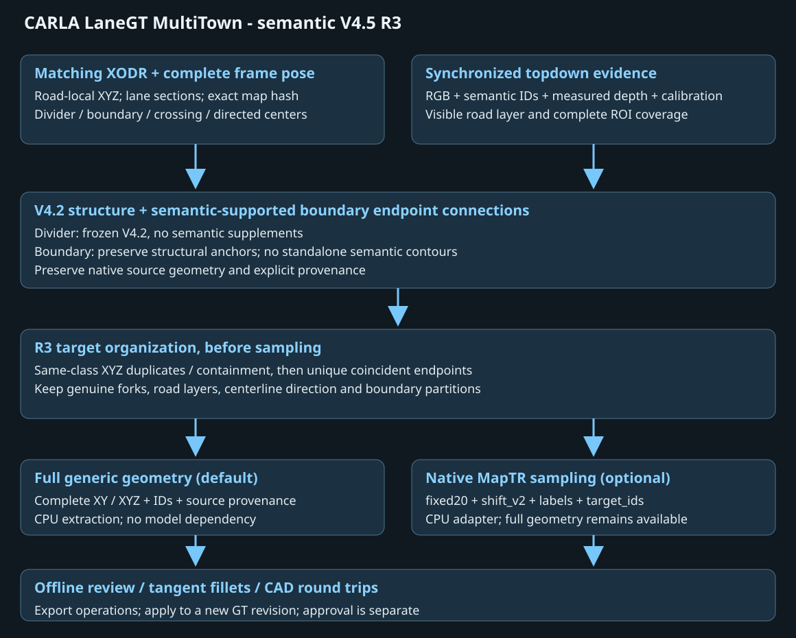
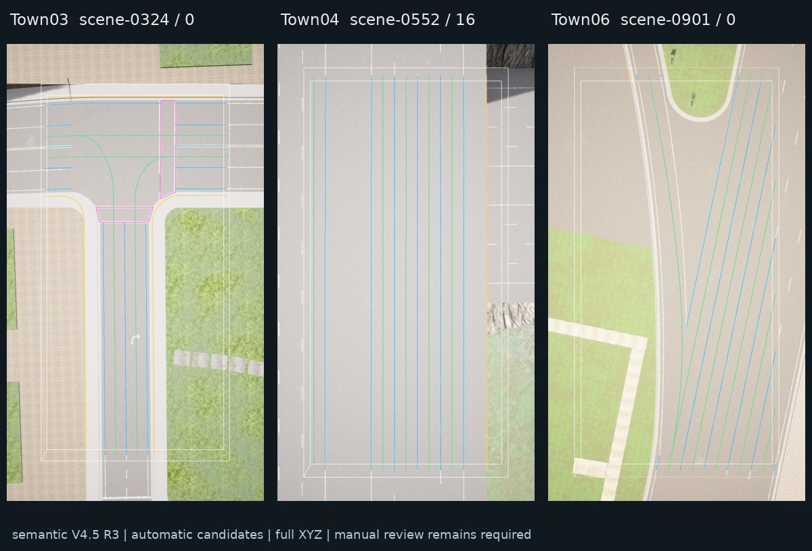
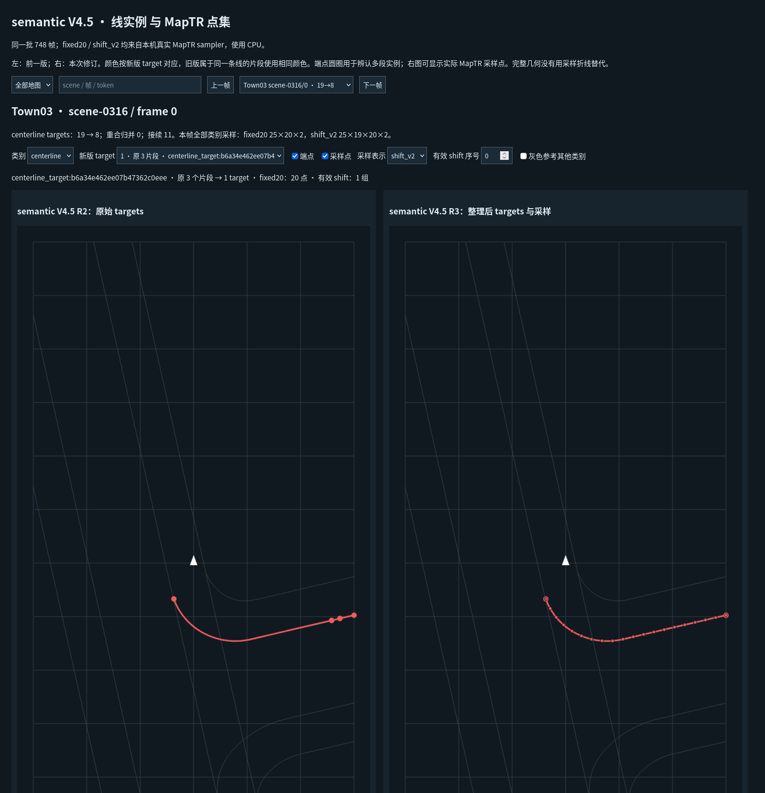
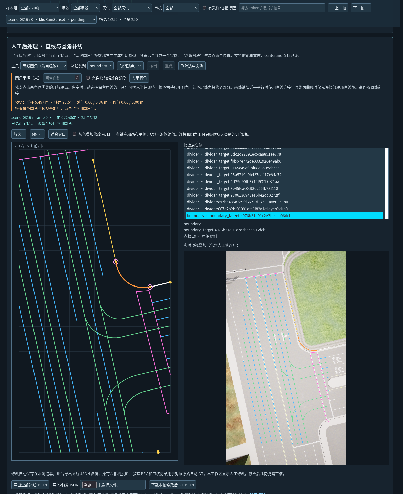

# CARLA LaneGT MultiTown

[English](README-EN.md) | 中文

从 CARLA 的匹配 XODR、顶视语义与实测深度生成道路矢量 GT，提供六相机投影、BEV 审核、页面圆角补线和 CAD 往返编辑。完整 XYZ 几何可独立使用；MapTRv2 的真实 `fixed20` / `shift_v2` 采样是可选适配。

**软件版本 1.0.0；默认方案 semantic V4.5 R3；几何基线 XODR-only V4.2。** 这是从 Town10 单地图项目发展出的独立 MultiTown 源码仓库。四类为 `divider`、`boundary`、`ped_crossing` 和可选 `centerline`。



## 当前方法

| 类别 | 几何来源与处理 |
| --- | --- |
| divider | XODR-only V4.2 原生 roadMark 与连接；关闭 semantic 漏线补充 |
| boundary | 保留 V4.2 road-local 结构，semantic / 实测 depth 仅提供结构端点连接证据；独立观测轮廓不加入 GT |
| ped_crossing | 同地图 XODR crosswalk 对象；源中没有对象时明确为空 |
| centerline | 同地图 XODR 车道中心线，保留行驶方向；支持 none / generate / provided |

采样前统一整理线实例：先检查同类 XYZ 重复及完整包含片段，再合并方向连续、关系唯一的重合端点。保留真实分叉、不同高度、平行线、centerline 方向及 boundary 有意切分。**保留原始几何和来源，不把固定点采样折线替代完整线。** 仍有错线与漏线需要人工修订。

## 跨 Town 使用

已在 CARLA 0.9.16 的 Town01–Town07、Town10（Town10HD/Opt）进行跨 Town 测试，整体流程基本可行。部分断线、漏线和误线可通过页面补线、两线圆角或 CAD 等人工后处理修订。



*Town03 / Town04 / Town06 的真实自动候选示例。坡度和高程使用完整 XYZ；图中候选仍可能需要人工修订。仅分发少量文档图片，不分发输入数据或 GT 数据集。*

## 快速开始

Linux，建议独立 Python 3.8–3.10 几何环境；安装依赖无需 GPU、CARLA 或 MapTRv2。

```bash
python -m pip install -r requirements.txt
python run.py --help
```

### 1. 为自己的地图准备资源

取得与实际 CARLA 服务器匹配的 XODR，离线构建 V4.2 资源和本地 map profile：

```bash
python tools/prepare_map.py --map Town03 --xodr /data/maps/server_Town03.xodr
```

命令输出生成的 `map_profile`、`capture_config`、`world` 路径。资源写入 Git 忽略的 `assets/` 与 `.local/`，不覆盖已有资源。可用 `--world` 显式复用匹配的 V4.2 缓存。此步骤不启动 CARLA；导出的 XODR 必须与后续真实捕获一致。

### 2. 配置与单帧检查

准备同步顶视数据、完整位姿及帧清单，复制并编辑配置示例：

```bash
cp config/paths.example.json /tmp/town03-paths.json
# 填写 prepare_map 的 map_profile、数据路径；采集时另填 capture_config / CARLA 路径
python tools/configure.py --from-json /tmp/town03-paths.json \
  --output config/paths.town03.local.json
python run.py --paths config/paths.town03.local.json doctor --topdown-only
python run.py --paths config/paths.town03.local.json check --limit 1 --topdown-only
```

已有通用顶视目录可用 `tools/prepare_topdown.py --map-profile PROFILE --topdown-root ROOT --output NEW_DIR` 生成清单草稿。普通六相机照片无法单独生成本工具要求的语义、深度和标定；完整要求见[数据接口](docs/INPUTS.md)。

### 3. 提取、审核和可选采样

```bash
python run.py --paths config/paths.town03.local.json extract --limit 1 \
  --topdown-only --centerline generate --output outputs/town03_gt
python run.py --paths config/paths.town03.local.json geometry-check --root outputs/town03_gt
python run.py --paths config/paths.town03.local.json review \
  --source outputs/town03_gt --output outputs/town03_review
```

用 Firefox 打开 `outputs/town03_review/gallery.html`。输出目录必须尚不存在。需六相机审核时配置对应图片和元数据，去掉 `--topdown-only`。

默认输出完整几何，不导入模型。需要真实 MapTRv2 点集时，配置外部 `model_root` / `maptr_python`，在提取时加入 `--sampler maptr`，或按[采样指南](docs/GENERIC_GT.md)导出。提取、采样和人工应用均在 CPU 上执行；只有显式顶视采集 `collect --execute` 启动 CARLA / GPU。

## 审核与人工修订



*同帧 target 整理前后对照，按实例着色并展示真实采样。较长曲线固定 20 点的表示偏差可能增加；可对照完整几何与采样图。*



*页面两线圆角支持自动／手工半径、预览、可选直线尾部修剪、撤销／重做及操作 JSON。人工操作应绑定对应版本的 GT，修订后可导出新的标注。*

## 文档导航

| 文档 | 内容 |
| --- | --- |
| [安装](docs/INSTALL.md) / [配置](docs/CONFIGURATION.md) / [完整操作](docs/QUICKSTART.md) | 依赖、每地图资源、配置、执行顺序 |
| [输入](docs/INPUTS.md) / [顶视接入](docs/TOPDOWN_INPUT.md) / [输出](docs/OUTPUTS.md) | 同步、坐标、哈希、JSON 与 NPZ 契约 |
| [算法](docs/ALGORITHM.md) / [最终方案](docs/SEMANTIC_V45.md) / [参数](docs/PARAMETERS.md) | V4.2 + semantic V4.5 R3 的实际规则 |
| [跨地图](docs/MULTITOWN.md) / [高程与 BEV](docs/BEV.md) / [采集](docs/CAPTURE.md) | 地图身份、覆盖、坡度、遮挡与显存控制 |
| [XODR-only](docs/XODR_ONLY.md) / [中心线](docs/CENTERLINES.md) / [模型适配](docs/GENERIC_GT.md) | 无顶视基线、方向与真实采样 |
| [页面后处理](docs/POSTPROCESSING.md) / [CAD](docs/CAD_GUIDE.md) | 直线、圆角、操作导出和 DXF 往返 |
| [问题排查](docs/TROUBLESHOOTING.md) / [已知限制](KNOWN_ISSUES.md) | 常见问题及人工处理事项 |
| [发布](docs/RELEASE.md) / [变更](CHANGELOG.md) / [第三方说明](THIRD_PARTY_NOTICES.md) | 文件范围、来源、许可与发布前检查 |

## 目录和发布范围

`src/` 包含采集、提取、审核、人工处理及模型适配代码；`web/` 包含离线界面；`tools/` 提供可移植入口；`config/` 保存公开策略和示例。CARLA / MapTRv2 为独立依赖；原始数据、地图资产、模型权重、运行输出、开发归档和本机路径配置不随源码发布。

代码采用 [MIT](LICENSE)；第三方代码、地图和数据遵循各自许可。代码来源和版本信息见 [RELEASE_SOURCE.json](RELEASE_SOURCE.json)。
