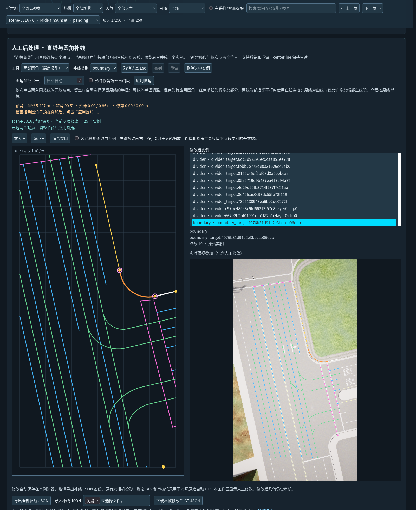

# 页面审核、直线与两线圆角

生成图册后，Firefox 打开 gallery.html。审核结论和几何补线分开保存：审核导出 JSON／CSV，几何编辑导出操作 JSON；二者不可互换。

## 编辑操作

- 连接断线：选择 divider 或 boundary，点击两个开放端点，直线连接并合为一个实例。
- 两线圆角：选择同类两线的开放端点，自动或手工输入半径，预览切点、延长和圆弧；确认后合为一个实例。
- 若指定半径需要切除现有直线尾段，必须显式勾选允许修剪；不允许删除整条线或沿弯曲尾段假装修剪。
- 支持新增线段、删除、撤销／重做；centerline 在人工编辑器中只读。复杂修改可走[CAD](CAD_GUIDE.md)。

圆角 XY 使用相切圆弧，高程按端点坡度与弧长插值，检查 BEV 和高度范围。页面与 Python 应用使用对应的几何校验，不只保存一张预览图。



右键拖动平移，Ctrl＋滚轮缩放，Esc 取消当前选点。颜色按类别，灰色用于编辑前参考。静态六相机和原始图片仍显示基础 GT，实时编辑画布才立即反映人工操作。

## 保存与应用

自动浏览器存储不能代替导出备份。换浏览器、图册版本或文件位置之前，分别导出审核记录和补线操作。

```bash
python run.py --paths config/paths.town03.local.json postprocess \
  --source outputs/review1 --patch /data/exports/geometry_edits.json \
  --output /data/lanegt/manual_v1
```

工具核对数据集身份、清单、原 GT 摘要及每条操作，生成新完整几何和图册。显式 --sampler maptr 才重新产生真实模型点集。源图册与外部图片／顶视数据保留，下一轮修改以新结果为 source。

新 GT 内容拥有新的身份。旧补线继续绑定旧图册，不修改哈希强行导入新 target；审核通过、算法采用、训练批准是不同状态。
