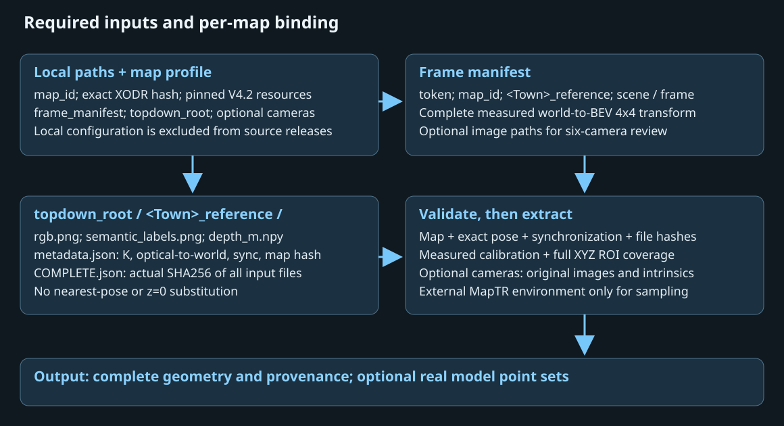

# 通用顶视数据接入

数据不限定 nuCarla。每个输入来源必须提供同步顶视 RGB、语义 ID、实测 depth、标定及完整位姿；跨 Town 使用情况见 [MULTITOWN.md](MULTITOWN.md)。

```text
/data/topdown/
└── Town03_reference_a/
    ├── rgb.png
    ├── semantic_labels.png
    ├── depth_m.npy
    ├── metadata.json
    └── COMPLETE.json
```

metadata 至少包含 map_name、source_frame_token、GT_model_from_world、intrinsic、optical_to_world_carla、image_size、semantic_ids、xodr_sha256、sensor_frame_ids 与 sensor_timestamps。COMPLETE 记录四个输入文件的实际 SHA256。详细字段与坐标见[输入契约](INPUTS.md)。

非 Town05 的 reference 带对应地图前缀；目录名、metadata.case_id（若提供）和帧清单一致。profile 的地图别名、XODR、缓存和捕获必须匹配。图像展示颜色不能代替语义 ID；相机覆盖不能代替同步或深度证据。



## 从现有顶视目录生成清单

先按[配置](CONFIGURATION.md)生成自己的 map_profile，再执行：

```bash
python tools/prepare_topdown.py --map-profile /absolute/path/to/profile.json \
  --topdown-root /data/topdown --output /data/prepared_metadata
python tools/configure.py --from-json /data/prepared_metadata/paths.json \
  --output config/paths.town03.local.json
python run.py --paths config/paths.town03.local.json check --limit 1 --topdown-only
python run.py --paths config/paths.town03.local.json extract --limit 1 \
  --topdown-only --centerline generate --output outputs/gt1
```

准备工具不改写原图、位姿或 metadata，也不启动 GPU；检查绑定、同步、地图、覆盖和摘要，输出 frames.json 与 paths 草稿。非默认 BEV 时，准备、检查和提取使用同样的 --bev-range。准备输出目录须不存在。

普通自包含参考不要求 cases。多帧共享参考时，cases 明确代表帧且完整 transform 逐值一致，禁止以最近位置替代。历史 nuCarla_frame 是 source_frame_token 的兼容别名，冲突会拒绝。

无六相机输入使用 --topdown-only。有相机时仍需实际图片、内外参和相机／ego 同步；没有从任意照片、视频推断这些字段的转换器。重新采集参考需自行准备 cases 及 capture_config，见 [CAPTURE.md](CAPTURE.md)。
